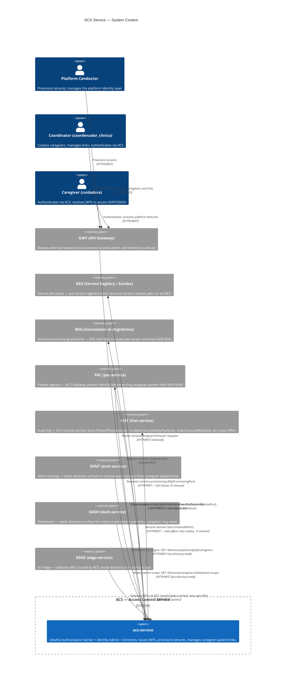

# C4 Context Diagram — `acs-service`

> Module: **ACS** · Generated by `/be-architect-specs-validate neuroassist-ai ACS` · 2026-07-29
> EARS gate: PASS · Refs: ADR-004, ADR-005, ADR-006

---

## Diagram

---

## Key flows

| Flow | Direction | Protocol | Auth |
|---|---|---|---|
| Authentication | `Caregiver → GWY → ACS /oauth2/token` | HTTPS/REST | none (public) |
| JWT validation | `Resource server → ACS /oauth2/jwks` | HTTP (internal, cached 300s) | none (public) |
| Tenant provisioning | `Conductor → GWY → ACS → MIG` | HTTP (internal) | `acs.tenant.provisionar` |
| Link creation | `Coordinator → GWY → ACS → PAC (validate)` | HTTP (internal) | `acs.vinculo.criar` |
| Alarm routing | `EVNT → ACS /directory/patients/{pid}/caregivers` | HTTP (internal) | `acs.directory.read` |
| Audit | `ACS → HIST (domain facts)` | HTTP (internal, best-effort) | service-to-service |

---

## Notes

- ACS is the **single source of truth** for tenant status (active/provisioning), caregiver status, and caregiver-patient routing.
- All resource servers (EVNT, DASH, PAC, EDGE, HIST) validate ACS-issued JWTs **without calling back to ACS** — they cache the JWK set.
- The directory surface must respond within **100ms p99** (SPEC-10 §3.2) — reads are same-node DB with indexed lookups.
- Messaging is **disabled** in MVP (`stack.messaging.enabled = false`); all interactions are synchronous REST (SPEC-09).
